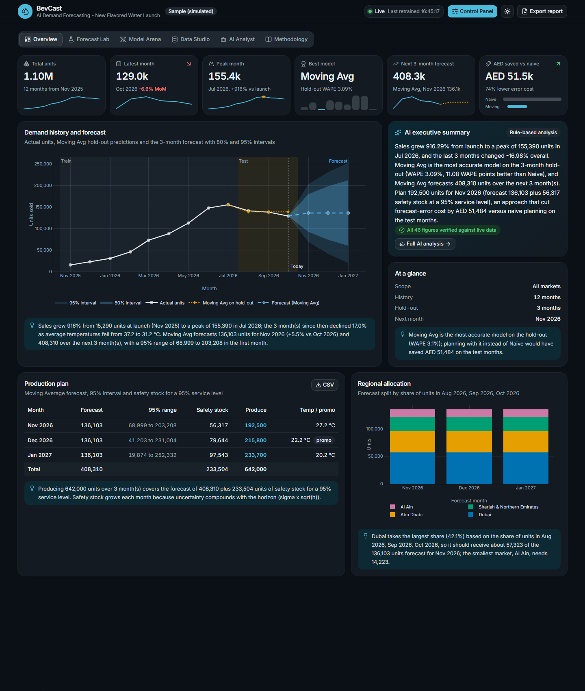
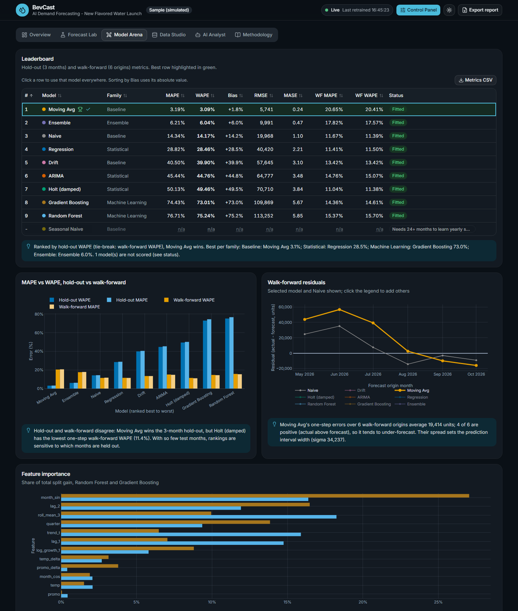
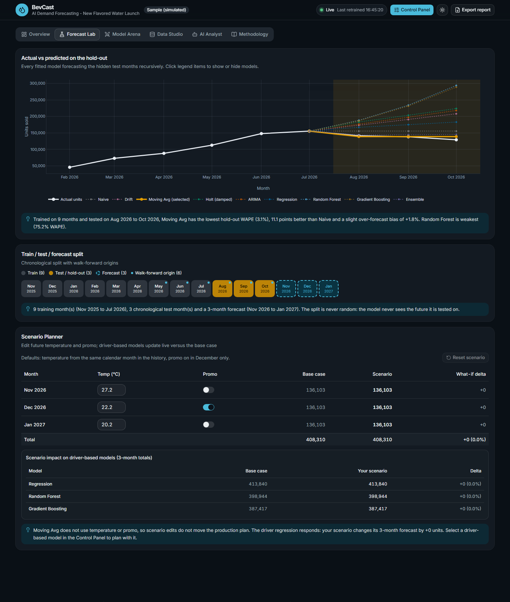
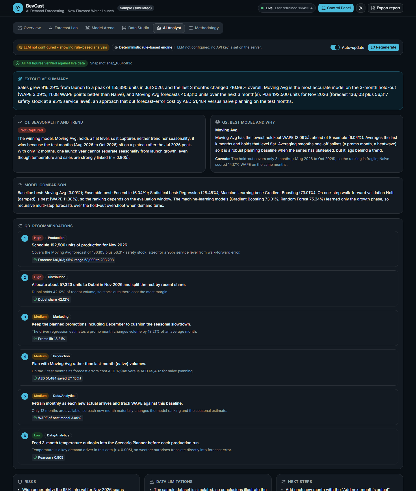
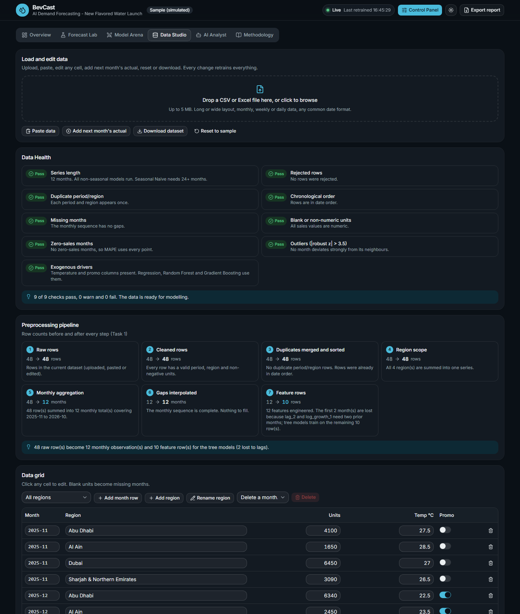
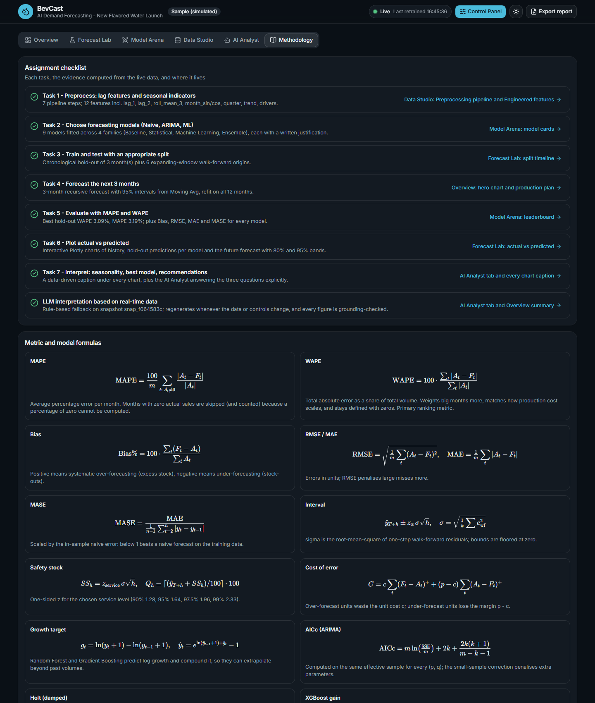
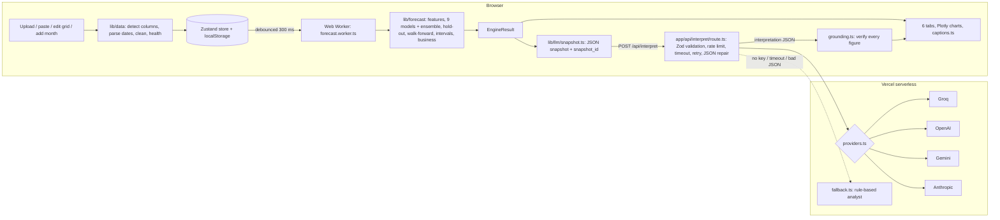

# BevCast - AI Demand Forecasting Dashboard

**AI Demand Forecasting - New Flavored Water Launch.** An interactive, production-grade forecasting dashboard built for the *AI in Operations* course (Master of AI in Business, SP Jain School of Global Management, Dubai).

A beverage company launched a flavored water in four UAE markets and has 12 months of sales. BevCast preprocesses the data, trains **9 forecasting models plus an ensemble** (all implemented from scratch in TypeScript), evaluates them with **MAPE and WAPE** on a chronological hold-out and an expanding-window walk-forward, forecasts the next 3 months with prediction intervals, turns the forecast into a **production and distribution plan**, and asks an **LLM to interpret the live results**, with every number it quotes checked against the data.

Everything on screen is computed at runtime from the current dataset. Edit a cell, upload a file or move a control and every model retrains in a Web Worker, every chart, KPI and caption updates, and the AI interpretation regenerates.

**Live demo:** https://bevcast-forecast-dashboard.vercel.app

---

## Screenshots

| Overview | Model Arena |
|---|---|
|  |  |
| **Forecast Lab** | **AI Analyst** |
|  |  |
| **Data Studio** | **Methodology** |
|  |  |

Any tab can be opened directly with `/?tab=overview | forecast-lab | model-arena | data-studio | ai-analyst | methodology`.

---

## Architecture



* **No Python backend.** The engine is pure TypeScript so it retrains instantly in the browser whenever data changes, and fits comfortably within Vercel's limits.
* **API keys never reach the browser.** The only LLM path is the server route.
* The sample dataset is also trained at build time so the first paint already shows real results; the worker then retrains live and produces the identical result (same data, same seed).

---

## Assignment mapping (Tasks 1 to 7)

| Task | What BevCast does | Where |
|---|---|---|
| **T1 Preprocessing** | Monthly aggregation, chronological sort, duplicate merge, gap detection and interpolation, outlier flags (robust z), `lag_1`, `lag_2`, `roll_mean_3`, `log_growth_1`, `month_sin/cos`, `quarter`, `trend_t`, `temp`, `temp_delta`, `promo`, `promo_delta`; before/after row counts for every step | Data Studio: Preprocessing pipeline, Engineered features, Data Health |
| **T2 Model choice** | 9 models in 3 families (Baseline, Statistical, Machine Learning) plus an ensemble, each with a written "why this model" | Model Arena: model cards |
| **T3 Train/test split** | Chronological hold-out (1 to 6 months, default 3) plus expanding-window walk-forward (one-step, shared origins) | Forecast Lab: split timeline; Model Arena: both metric sets |
| **T4 Forecast 3 months** | Recursive multi-step forecast after refitting on all data; horizon 1 to 12; 80% and 95% intervals | Overview: hero chart and production plan |
| **T5 MAPE and WAPE** | Exact, zero-safe formulas plus Bias %, RMSE, MAE, MASE | Model Arena leaderboard, KPI cards, Methodology formulas |
| **T6 Actual vs predicted** | Interactive Plotly charts with hover, zoom, legend toggles and PNG export | Overview and Forecast Lab |
| **T7 Interpretation** | A deterministic, data-driven caption under every chart plus an LLM analysis answering the three questions | Every chart; AI Analyst tab |
| **LLM on real-time data** | Live JSON snapshot sent to the server route, auto-regenerated when the snapshot changes, grounding check on every figure, Ask the Analyst chat | AI Analyst tab, Overview summary card |
| **Business impact** | Safety stock by service level, recommended production, regional allocation, AED cost of forecast error vs naive planning | Overview: production plan and regional allocation |

---

## Models (all implemented from scratch in `lib/forecast/`)

| Model | Family | Notes |
|---|---|---|
| Naive | Baseline | Last value. The benchmark; MASE is scaled by its in-sample error. |
| Drift | Baseline | Line from the first to the last observation, extended. |
| Moving Average (k) | Baseline | Mean of the last k months (k = 2 to 6), held flat. |
| Seasonal Naive | Baseline | Same month last year; enabled from 24 months. |
| Holt's linear trend (damped) | Statistical | Grid search alpha, beta in 0.05..0.95 and phi in {0.8, 0.9, 0.98, 1.0} on one-step SSE. |
| ARIMA(p,d,q) + drift, auto | Statistical | d by the variance-reduction rule (max 2), p, q in 0..2, Conditional Sum of Squares with a Nelder-Mead optimiser, AICc on a common effective sample, roots checked for stationarity and invertibility, optional seasonal difference (lag 12) from 24 months. |
| Regression with drivers | Statistical | Ridge OLS (lambda 1e-3, standardised) `units ~ trend + temp + promo`, Gaussian elimination with partial pivoting; falls back to `units ~ trend`. |
| Random Forest | Machine Learning | Bootstrapped CART trees, mtry = ceil(p/2), min leaf 2, seeded. Target is **month-on-month log growth**, compounded back to units, because trees cannot extrapolate beyond their training range. |
| Gradient Boosting (XGBoost-style) | Machine Learning | Second-order gain with L2-regularised leaf weights (lambda 1, gamma 0), shrinkage, 80% row and column subsampling, same growth target. |
| Ensemble | Ensemble | Inverse hold-out WAPE weights over the top 3 models (its hold-out score is optimistic, as noted in the UI). |

Feature importance (total split gain, normalised to 100%) is reported for both tree models. Every fit is wrapped so a failing model shows "Not fitted: reason" while the others continue.

### Results on the shipped sample dataset (default settings)

Hold-out = Aug to Oct 2026, walk-forward origins = May to Oct 2026. Reproduce with `npm run leaderboard`.

| Rank | Model | Hold-out MAPE | Hold-out WAPE | Bias | Walk-forward WAPE |
|---|---|---|---|---|---|
| 1 | Moving Average (k = 3) | 3.19% | 3.09% | +1.8% | 20.41% |
| 2 | Ensemble | 6.21% | 6.04% | +6.0% | 17.57% |
| 3 | Naive | 14.34% | 14.17% | +14.2% | 11.39% |
| 4 | Regression (trend + temp + promo) | 28.82% | 28.46% | +28.5% | 11.50% |
| 5 | Drift | 40.50% | 39.90% | +39.9% | 13.42% |
| 6 | ARIMA(0,1,0) + drift | 45.44% | 44.76% | +44.8% | 15.07% |
| 7 | Holt (damped) | 50.13% | 49.46% | +49.5% | 11.38% |
| 8 | Gradient Boosting | 74.43% | 73.01% | +73.0% | 14.61% |
| 9 | Random Forest | 76.71% | 75.24% | +75.2% | 15.70% |

Interpretation: the hold-out months sit on the post-peak plateau, so a flat 3-month average wins; trend models trained only on the launch growth phase over-forecast. On one-step walk-forward the ranking flips (Holt, Naive and Regression lead), which is why both validation designs are shown. Using Moving Average instead of naive planning would have saved AED 51,484 in forecast-error cost on the test months.

---

## Metrics

* MAPE = (100/m) x sum |A - F| / |A| over months with A != 0 (zero actuals are skipped and counted)
* WAPE = 100 x sum |A - F| / sum |A| (primary ranking metric)
* Bias % = 100 x sum (F - A) / sum A (positive = over-forecasting)
* RMSE, MAE, and MASE = MAE / in-sample naive MAE
* Interval = forecast +/- z x sigma x sqrt(h), sigma = root-mean-square of walk-forward residuals, floored at 0
* Safety stock = z(service level) x sigma x sqrt(h); production = forecast + safety stock rounded up to 100 units
* Cost of error = over-forecast units x unit cost + under-forecast units x (price - cost)

The Methodology tab renders all formulas with KaTeX.

---

## Run locally

Requires Node 22 or newer.

```bash
npm install
npm run dev          # http://localhost:3000
npm test             # 107 unit, stress and LLM-route tests
npm run leaderboard  # prints the leaderboard on the sample data
npm run build        # production build
```

Optional: copy `.env.example` to `.env.local` and set one LLM key (see below).

---

## Upload your own data

Data Studio accepts **CSV, TSV, TXT, XLSX and XLS (up to 5 MB)**, pasted cells from Excel or Google Sheets, inline edits, and an "Add next month's actual" form.

* **Columns are detected automatically** (case-insensitive, with synonyms): period `month, date, period, time, yyyymm, month_year`; sales `units, sales, qty, quantity, demand, volume, revenue, value`; region `region, market, area, city, territory, store`; temperature `temp, temperature, avg_temp, avg_temp_c`; promo `promo, promotion, campaign, discount_flag`. If detection is uncertain a Column Mapping dialog opens with a preview.
* **Layouts:** long (one row per month and region), wide with regions as columns, or wide with months as columns.
* **Dates:** `YYYY-MM`, `YYYY-MM-DD`, `DD/MM/YYYY`, `MM/DD/YYYY` (ambiguity resolved per column), `Jan 2025`, `January-2025`, `Jan-25`, `202511` and Excel serial numbers. Daily or weekly data is aggregated to monthly with a notice.
* **Numbers:** thousands separators, currency symbols and `AED` prefixes are stripped. Blank values become missing months (interpolated, drawn hollow); negative values are rejected with the row number; zeros are allowed; outliers are flagged, never deleted.
* No region column gives one series named "All Markets"; no temperature or promo column switches driver models to trend and lag features only.
* Fewer than 4 months shows a blocking message (Data Studio stays usable); 4 to 7 months runs Naive, Drift, Moving Average and Holt; 8+ runs every non-seasonal model; 24+ adds Seasonal Naive and seasonal ARIMA.

---

## Environment variables

Set these in `.env.local` locally or in Vercel's project settings. Only one key is needed.

| Variable | Default model |
|---|---|
| `GROQ_API_KEY` | `llama-3.3-70b-versatile` |
| `OPENAI_API_KEY` | `gpt-4o-mini` |
| `GEMINI_API_KEY` | `gemini-2.0-flash` |
| `ANTHROPIC_API_KEY` | `claude-haiku-5-5` |
| `LLM_PROVIDER` | optional: force `groq`, `openai`, `gemini` or `anthropic` |
| `LLM_MODEL` | optional: override the model name |

`GET /api/interpret` returns `{ configured, provider, model }` and never exposes a key.

If a provider has retired the default model, the server lists that provider's current models with the same key, switches to the best available chat model, retries, and remembers the choice. No redeploy or code change is needed. If one model hits the provider's free-tier rate limit, that request is retried once on another model (each model has its own quota), and a rate-limited result is retried automatically after a minute.

---

## How the LLM interpretation stays grounded

1. **Real-time snapshot.** `lib/llm/snapshot.ts` builds a compact JSON of the live results (monthly actuals, summary statistics, leaderboard, best model, forecast, plan, allocation, cost of error, warnings, scenario). Its `snapshot_id` is a hash of the data, settings and scenario.
2. **Strict prompt.** The system prompt (`lib/llm/prompts.ts`) tells the model to use only numbers from the JSON and to answer the three assignment questions explicitly.
3. **Validated output.** The reply must be JSON matching a Zod schema; if it is not, the route asks once more with a repair message, then falls back to the rule-based analyst.
4. **Figure-by-figure check.** `lib/llm/grounding.ts` extracts every number from the text and verifies it against the payload (within 1% or the rounding used). The UI shows "All N figures verified against live data" or underlines unverified figures in amber.
5. **Always available.** With no key, a timeout or invalid output, `lib/llm/fallback.ts` produces the same schema deterministically from the snapshot, clearly labelled.
6. **Stays current.** The analysis regenerates automatically when the snapshot changes (debounced 1.5 s, cached per snapshot); an older analysis is marked "Stale - data changed".

---

## Deploy (GitHub + Vercel)

```bash
git init
git add .
git commit -m "BevCast forecasting dashboard"
git branch -M main
git remote add origin https://github.com/samuelalex3737/bevcast-forecast-dashboard.git
git push -u origin main
```

Create the empty repository `bevcast-forecast-dashboard` on GitHub first (no README, no .gitignore). Then:

1. On vercel.com choose **Add New, Project**, import `bevcast-forecast-dashboard` (framework preset: Next.js, defaults are correct).
2. Under **Environment Variables** add `GROQ_API_KEY` (or another provider key).
3. Click **Deploy**.
4. Open `https://bevcast-forecast-dashboard.vercel.app/api/interpret`; it should return `"configured": true`.
5. Open the site: the sample data loads, and the AI Analyst shows "LLM connected".

---

## Quality checks

* 107 Vitest tests: hand-computed metrics, every model (including ARIMA recovering an AR(1) coefficient and Holt on a perfect line), linear algebra, the 18 professor stress scenarios, LLM route resilience (no key, malformed JSON, timeout, 5xx retry, retired or rate-limited model, rate limit, oversized body), grounding, and house-style checks (no em dash, no TODO markers).
* Every stress scenario asserts that no NaN or Infinity appears anywhere in the result, captions, snapshot or fallback analysis.
* Lighthouse (production build): desktop profile Performance 96, Accessibility 100, Best Practices 100. On the default mobile profile (simulated slow CPU) Accessibility and Best Practices are 100 and Performance is about 70, limited mainly by parsing the charting library.

---

## Limitations

* 12 months cannot identify true yearly seasonality: the summer peak is confounded with launch-phase growth. Temperature acts as a proxy, but only a second year can confirm the cycle.
* Lag features consume the first 2 months, so the tree models train on few rows and overfit easily.
* A 3-month hold-out makes rankings fragile; compare hold-out and walk-forward before trusting a winner.
* Hold-out scores use the realised temperature and promo of the test months; live forecasts depend on assumed temperatures.
* Intervals assume errors grow with sqrt(h) and ignore parameter uncertainty and structural breaks.
* The variance-reduction rule for ARIMA differencing can over-difference a moderately persistent stationary series.
* Regional allocation assumes the recent regional mix holds over the horizon.
* **The sample dataset is simulated.** Results illustrate the method, not real market behaviour.
